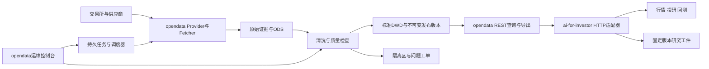

# 架构设计

## 1 采用模块化中台与独立运行进程

opendata 保持一个仓库和统一领域模型，分别运行 REST API、调度器、采集worker；初期沿用现有数据库和迁移体系。ai-for-investor 是消费方。先复用 MySQL/现有仓储、SQLAlchemy、FastAPI、APScheduler和Redis限流；共享数据缓存如采用需新增实现，不承担唯一运行历史。数据库承载持久任务、租约和发布记录。

现有分钟归档仅覆盖特定四域及分钟频率，采用本机不可变Parquet和有界JSON查询，不保证多主机共享文件锁。普通DWD导出为CSV、native-model导出为NDJSON。通用raw artifact存储、跨主机工件访问、异步大文件REST下载是本迭代A04/A05的新工作，不能假设已经存在。

不在本迭代同时更换数据库、引入多套工作流平台或重建所有Provider。是否引入队列产品、对象存储集群、分析型数据库由实际容量决定：记录行数、字节、写入吞吐、最重查询、磁盘增长、备份时间，再提出独立ADR。

业务仓库读API不因查询触发外部抓取。现有provider-model query属于受source policy约束的即时抓取能力，与warehouse read和ingest分开，不开放给ai普通读Key。缺失数据返回真实状态，由独立补数请求或周期任务处理；ai-for-investor普通读身份无直接执行脚本或源抓取权限。用户发起数据准备时可通过单独窄权限身份提交声明式请求，由opendata做去重、预算与策略校验。

## 2 数据所有权与领域边界

| 领域 | opendata负责 | ai-for-investor负责 |
| --- | --- | --- |
| 市场事实 | 原始响应、标准值、主数据、版本、修订、来源、授权 | 按契约展示与使用，保存引用 |
| 金融语义 | 单位、币种、交易日历、时区、复权、财务披露和版本 | 策略参数、评估方法和交易含义 |
| 数据可用性 | 覆盖范围、缺口、新鲜度、许可、质量与可用版本 | 研究/交易对新鲜度和质量的要求，失败时业务处理 |
| 研究衍生物 | 可共享基础因子可另登记；不自动吸收业务模型 | 策略专有因子、模型、信号、训练划分、报告、订单 |
| 用户上传 | 需要复用时经私有数据导入API治理，带owner和授权 | 临时实验工件可保留；禁止把共享盘当数据接口 |
| 授权 | 数据集/来源/租户使用权限 | 用户研究权限、sealed数据集隔离、输出许可、投资业务权限 |

市场参考数据管理页面迁移；ai的行情页、数据可用性提示和研究预检保留。opendata不得接管投资账户、券商密钥或用户订单。交易网关协议若携带即时成交参考报价，应在台账明确标为交易控制输入；公共行情获取仍走中台。低延迟流式行情若需要后续扩展单立ADR，本轮REST目标不承诺高频交易时延，也不得成为暗中保留直连爬虫的理由。

## 3 数据契约与主数据

每个 `dataset_id + schema_version` 有一份版本化契约，集中维护而不是由脚本各自定义：

- 身份：资产类型、稳定 `instrument_id`、venue、源代码映射和生效期。股票换码/退市、基金份额类别、期货期权到期、连续合约规则、FX与crypto base/quote 明确建模。
- 粒度：自然业务键、频率、数据形态、排序、唯一约束。期权链/曲线/财务表不能统一压成OHLCV；宏观修订包含vintage维度。
- 时间：交易业务日 `business_date`、事件时刻 `event_at`、源公布时刻 `source_published_at`、采集时刻 `observed_at`、本平台可用时刻 `available_at`、发布时间 `published_at` 分开。来源没给出的时间为未知，不用采集时间冒充历史披露时间。
- 值：原始字段和单位留ODS；DWD定义币种、计价单位、价格精度、volume/amount单位、空值含义、复权方式和因子版本。Decimal序列化方式写入schema，不依赖浮点默认行为。
- 质量：必填、业务域规则、主键、跨表一致性、覆盖/时效、源冲突处置、严重度。规则依数据集定义，不能用“所有价格必须正数”错误拒绝可能为负的合法品种价格。
- 服务：可读字段、查询窗口、最大行数、分页、可用索引、可接受时效、更新和回补策略、许可与保留期限、负责人。

金融语义必须满足：

1. 不复权行情与因子/公司行动分别保留。旧qfq/hfq数据只能标明原始基准导入；无法可靠逆推出原价时保持独立数据集，不伪装成unadjusted。计算复权的锚定日、算法与因子版本固定。
2. 基金单位净值、累计净值、万份收益、七日年化、交易价格分别建模；国债收益率曲线不作为债券个券价格。
3. 期货精确合约、连续合约、主力拼接、TAS价差分别建模。成交量/持仓量单位、结算价和收盘价不互换。
4. 夜盘归属交易日、节假日、半日市、DST、crypto UTC日桶由版本化日历决定；按来源真实发布节奏判断freshness，不能所有源统一“今日应有”。
5. 退市标的、到期合约、历史指数成分和历史universe纳入回测，避免幸存者偏差。
6. PIT查询必须同时满足“当时已对外公布”和“当时平台可得”。历史回填只有业务日期不自动获得可证明的历史可得性；`pit_status=unknown` 的数据不得进入严格PIT研究。

## 4 存储 清洗 发布与修订

复用现有 `ods_<domain>_<source>`、`dwd_<domain>`、metadata库及双Alembic体系，增量补齐缺失的元数据实体：dataset/schema、instrument别名与生命周期、raw artifact、partition/window coverage、DQ结果、publication/snapshot、run/lease、migration ownership。

原始层保存抓取请求摘要、来源URL、响应状态、采集时间、内容哈希、源版本和受控工件地址，去除密钥/Cookie。ODS保留源语义，DWD可追溯到raw/ODS与转换代码版本。未知或错误值保留隔离证据，不用默认零/前值掩盖失败。

发布链：`抓取 → raw/ODS → 标准化 → DQ → 候选分区 → 校验 → 原子切换publication指针`。可采用版本列/分区清单实现；A在M0依据现有表容量选择具体形式。API只能看到已提交且质量可发布的版本，不能看到半批数据。数据写入与watermark在同一数据库事务内推进；文件与数据库之间使用staged manifest及可重放提交，故障后清理孤立工件。跨metadata/warehouse数据库不假设存在单机事务：receipt/outbox携带唯一publication_id并可重放，状态不得领先事实。

业务键唯一约束+幂等upsert/版本追加保证重复运行不产生重复事实。上游更正追加revision，保留旧快照和修订链；消费者主动选择最新或固定版本。删除/保留策略覆盖原始证据、快照、导出、缓存和备份，遵循源许可，并提供撤销版本通知。

迁移不顺带升级所有数据库。opendata当前native-model落盘路径包含MySQL版本要求，M0核实实际环境；SQLite只作局部单元测试。任何宣称支持的生产数据库必须独立通过迁移、锁、并发、分页和恢复验证。

## 5 全历史治理

完整性单位为 `数据集 × 来源 × 标的或源业务键 × 时间分区 × 语义版本`。分别记录独立证明的上市/成立日、用户要求起点、源最早返回日、已观察最早日、最后完整分区和内部缺口。市场整体首日不能代替每只标的起点。

覆盖分母来自生命周期与日历，并纳入退市/到期对象；对于曲线/财务/宏观则按真实发行周期和业务键定义。分别输出head/interior/tail缺口、重复、冲突、停牌/不适用、未知、源不可得。整表MAX和成功执行数仅是运维指标。

`COMPLETE / PARTIAL / UNKNOWN / SOURCE_LIMITED / NOT_APPLICABLE` 是覆盖结论，不是调度状态。`SOURCE_LIMITED` 要有请求范围、真实证据、再次评估条件与责任人，历史需求保持开放。快照源只从开始归档日起形成历史，不能把今日快照复制为过去日期。历史恢复与近期补偿分成不同任务，恢复任务有断点、公平调度、预算和冷却。

## 6 REST与客户端合同

### 6.1 现有接口继续兼容

优先复用 `GET /api/v1/data/{asset_class}/{domain}`，如 `/api/v1/data/equity/stock_daily`；现有日期是闭区间，返回 `success/message/data`，data含 `columns/rows/page/page_size/count`，count是当前页行数。v1保持latest-view与既有分页语义，不保证跨页固定快照；严格研究走新的snapshot/export合同。ai内部半开窗口由单一适配层转换，不能各页面自行减日期。现有Provider目录、schema、warehouse query/export也可复用，但即取query/ingest不是业务读默认入口。

opendata-client当前同步客户端与ai现有异步httpx适配器不能在异步API内直接阻塞调用。E选择扩展独立client的Async版本或保留薄异步REST适配器，以同一OpenAPI和契约fixture验证；不能引入opendata服务内部Python包。客户端固定版本，只含HTTP、认证、序列化、分页与错误映射，不复制清洗和源选择逻辑。

### 6.2 新增合同候选

下表为**待实现的v2契约提案**，不是已存在路由。A/E在M0生成可机器校验的OpenAPI并冻结v0.1，v1不作破坏性修改。采用OpenAPI 3.1兼容工具链描述接口与schema。[OpenAPI规范](https://spec.openapis.org/oas/v3.1.1.html)。

| 端点候选 | 用途和约束 |
| --- | --- |
| `GET /api/v2/datasets`、`/{dataset_id}` | 目录、契约、真实能力、质量和许可；按身份过滤 |
| `GET /api/v2/instruments`、`/calendars/{calendar_id}` | 标的、别名/生命周期、日历版本；分页和as_of |
| `GET /api/v2/datasets/{dataset_id}/records` | 只读已发布数据；instrument_ids、start/end、frequency、adjustment、as_of或snapshot_id、fields、cursor、limit |
| `GET /api/v2/datasets/{dataset_id}/coverage` | 逐标的窗口覆盖、缺口、起点证据、freshness与限制 |
| `POST /api/v2/snapshots`、`GET /api/v2/snapshots/{id}` | 固定publication、版本、过滤条件和内容哈希；只基于已发布数据 |
| `POST /api/v2/exports`、`GET /api/v2/exports/{id}`、`/{id}/content` | 大批量异步导出；REST流式下载、manifest/hash、断点/过期语义 |
| `POST /api/v2/data-requests`、`GET /api/v2/data-requests/{id}` | 声明数据准备需求，202+状态URL；独立scope、去重、配额，无任意脚本参数 |
| `/api/v2/admin/job-definitions`、`/runs`、`/backfills` | 运维控制面，独立管理员权限；沿用现有管理功能演进 |

成功响应复用外层信封，新增meta含 `dataset_id/schema_version/publication_id/snapshot_id/request_id`、`quality_status/coverage_status/freshness_status`、`as_of/observed_at`、`next_cursor/has_more`、源与限制。空结果区分“合法无记录”“窗口未覆盖”“权限拒绝”，不把所有失败返回200空数组。错误包含稳定 `code/message/request_id/retryable`，不暴露SQL/密钥。

建议错误：400非法范围、401未认证、403越权、404资源不存在、409契约/快照冲突、410导出或版本已过期、422不支持语义/频率、429配额、503不可用。元数据可返回PARTIAL；严格研究的数据请求在不满足要求时明确失败或返回缺口，不能自动扩大请求或换源。

记录API时间窗口在v2统一为 `[start,end)`；日线使用业务日期，intraday使用带时区RFC3339时刻。严格PIT和固定snapshot请求的互斥/组合语义写入schema。cursor绑定权限主体、过滤条件、稳定排序键和publication版本，增量发布期间翻页不丢不重；超限显式报错或转导出，禁止静默截断。

初始容量预算（M0用实际数据校准）：单页默认1,000行、最大10,000行且压缩前响应不超过8MiB；同步完整查询最多100,000行，更大走导出；导出按100,000行分块，内存上限256MiB。单请求超时及整次分页总deadline分别限制，429遵循Retry-After；幂等读有限重试，创建任务需Idempotency-Key。缓存键含身份scope、契约、版本、复权、as_of和过滤条件，快照ETag可复用；密钥/授权变更使授权缓存失效。

## 7 调度与任务模型

TaskDefinition声明 `job_id/version/dataset_id/provider/model/query_template/universe_policy/calendar/timezone/schedule/release_delay/overlap_policy/resource_budget/retry_policy/owner`。cron只是触发条件，不能等同预期数据已发布；夜盘、延迟发布、周月报有各自补偿窗口。

所有入口（定时、手动、CLI、API、systemd）统一提交同一Run服务。APScheduler只负责触发；真实运行状态、进度、租约、尝试次数和下次计划在DB中。调度器独立于web worker，先单实例运行；即使误起两个实例，也须由数据库领取与写入fencing防重复。Redis锁不能单独承担最终数据安全。

Run状态建议：`QUEUED → CLAIMED → RUNNING → VALIDATING → PUBLISHED`；异常为 `RETRY_WAIT/FAILED/CANCELLED/PARTIAL`。完成执行和发布状态可分别建字段；无新数据且已核验覆盖可 `SUCCEEDED_NO_CHANGE`，空源且未覆盖不能称成功。cron occurrence身份包括job版本、计划时刻UTC、分片和运行类型；补数还包括明确范围及请求幂等键，避免同日人工执行错误占用后续自然槽。

至少一次投递+幂等写入，不承诺端到端exactly-once。worker有租约、心跳、超时、取消、有限重试；旧worker恢复后因fencing token过期不能写入。占用并发额度后再领取，避免排队任务过期。阻塞SDK与浏览器采集运行在可终止的有界子进程，保留退出码与截断日志；不在web事件循环执行。

按供应商域名/凭证做全局速率限制、指数退避与抖动、熔断和冷却，尊重Retry-After；源WAF/授权失败不无限重试。核心更新、用户数据准备、历史恢复分别分配资源，历史恢复不能挤占日更。源故障、代码错误、质量拒绝、授权不足、资源耗尽分别告警。systemd外壳如继续保留，只能调用统一run入口，不能旁路写仓。

## 8 安全 可观测性和运维

复用opendata的API Key、域scope和source-use policy的fail-closed技术闸门与证据引用。当前operator grant及其evidence字段不证明真实数据权利已经审查，域scope也不等于租户/用途/再分发授权。模型级权利审核、有效期、下游用途与导出授权由A/B/C补齐；新增data.read、snapshot/export、data.request、job.manage、source.credentials操作权限。普通ai服务账号只有必要的读域；回填身份单独签发，禁止共享管理员JWT。跨机器HTTPS，本机也有认证和网络边界；备份加密、凭据轮换、日志脱敏。任意SQL、源URL、脚本内容或文件路径不能作为普通用户可控的执行参数。

迁移脚本在每次写入前确认包实际路径、仓库版本、环境标识、数据库服务器/库名与部署指纹，并校验允许目标；dry-run使用只读角色，写入模式显式apply。避免重复发生203中editable install解析到另一仓库导致跨库误写的问题。DDL账号、数据写账号、查询账号分离。

trace_id/request_id连接ai请求、opendata查询、run、source request和publication；指标、日志、trace统一关联。OpenTelemetry提供这三类信号能力，可复用现有埋点。[OpenTelemetry Signals](https://opentelemetry.io/docs/concepts/signals/)。指标包含发布延迟、逐分区覆盖、质量拒绝、重试/源失败率、队列等待、孤立租约、限流、API p95/p99、导出内存、磁盘水位、备份恢复和成本；高基数instrument细节放事件/报告，不逐码创建指标标签。

首期建议SLO：核心读API月可用性99.9%；本地索引命中的单标的近一年日线在20并发下p95≤500ms；元数据p95≤300ms；全量导出20分钟内或按冻结容量预算完成。数据freshness按源发布时间+容许延迟逐域定义，不能沿用统一秒数。RPO≤24h、RTO≤2h作为初始恢复目标，必须经真实备份恢复演练校准。预算/SLO是设计目标，当前无达标声明。

数据运维控制台显示目录、来源与许可、执行与下次运行、逐标的覆盖、DQ隔离、补数/取消/重放、血缘、凭据健康与容量。停止按钮须真实取消或标出“等待当前不可中断步骤”；隐藏按钮不能替代后端授权。
