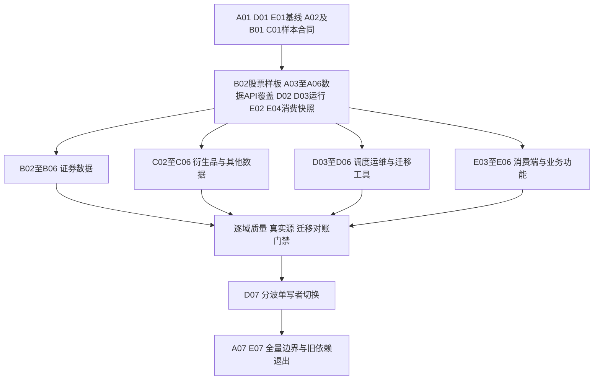

# 五人实施计划

本文件保留35个工作包的原始规划。98个子任务及“截至2026-10-29 的 8 项 DEV_DONE、11 项 IN_PROGRESS、79 项 PLANNED”是当日的历史计划快照，不是当前状态统计；旧 WAVE 文档中的87项统计也属于更早快照。后续局部 PR 不自动关闭子任务或父工作包。子任务清单在2026-10-30新增了全A股逐证券全历史回补控制任务 `204-B05-03`；该任务不属于原98项快照，不能据此推算实时总数或完成比例。当前核对基线、#132–#149 与 AFI #201–#203 的限定验收及尚未完成的关键依赖见下文和[子代理任务清单](SUBAGENT_TASKS.md)。在按当前证据逐项重算之前，不报告当前完成数量或比例。开发人员用A–E占位；任务分配是责任约定，不表示已经开始实现。A兼任技术负责人和跨仓集成人，不额外假设第六名全职人员。

## 当前核对基线与可执行顺序（2026-10-31 更新，Asia/Shanghai）

**2026-10-31 基线**：ai-for-investor `dev` HEAD 为 `733655f8a3dcf20bd37ee0fb72e1d147b54194a6`，OpenData `dev` HEAD 为 `7cc613bfc15fc3e35da9213d204955e269ae1b83`。该基线不包含本次文档改动；后续验收或实现必须重新绑定实际 HEAD、差异和脏文件哈希。

OpenData #134–#149 在既有隔离范围内补齐一次性 source gate/quota/transport 绑定、CSI500 样本准备 CLI、离线股票日线缺口对账、硬禁用的 v2 日线读取路由、THS job 请求预算传递、MySQL 反射 CHECK 校验、DWD diff 标记修正及模拟 THS 的 MySQL 竖向验收夹具；AFI #201–#203 合入精确 snapshot grant 存储、固定股票日线 publication 读取器和按可验证数据闭环排序的迁移计划。提交信息与文档未记录测试通过数/覆盖率。上述增量仍只覆盖代码/离线范围，没有真实来源请求、生产 MySQL、AFI 业务接线、自然周期、单写者切换或全历史证据；按该 HEAD 的合入内容（不含工作树未提交改动），没有证据表明这些新入口已注册为生产任务，v2 日线路由仍硬返回 404。详细划分见 [DEVELOPMENT_STATUS.md](DEVELOPMENT_STATUS.md) 的 2026-10-31 条目。

**2026-10-30 历史快照**：本轮编辑这些计划文档之前，ai-for-investor `dev` 与 `origin/dev` 的 HEAD 为 `73c7b2f7537cacab2ab75daf4381e850a0977b9b`，OpenData `dev` 与 `origin/dev` 的 HEAD 为 `cc79654171bd00b00d9909f7973547a10790a945`；当时两处工作树均干净。该基线不包含当时的文档改动。

OpenData PR #132（`1bbc85bd4559634bb24ba2a6894f339efa136b97`）的限定隔离回归为487项通过、1项既有 OpenAPI 检查明确 deselect；full-follow mypy 仍有3项既有诊断。它新增签名恢复日志，但任务仍 disabled、unregistered、无 scheduler/生产签名器，账本提交与日志发布也没有原子链接。PR #133（`cc79654171bd00b00d9909f7973547a10790a945`）的限定合成回归为68项通过、statement+branch 覆盖率96.77%，只增加 CSI500 历史缺口对账模型。二者均不证明真实数据已采集、生产调度可恢复、全A股已覆盖或上市起点至今全历史完整。AFI #193 只合入纯策略；授权持久化模型/迁移当前仍处于本地开发中，未合入记录的 AFI HEAD、未验收，也不构成可信 grant registry 或可用授权功能。**更正（2026-10-31）**：AFI #201（`1af1366cccbdeef57d7c84c15820d556124c8cf8`）已把精确 grant 的 ORM 模型与迁移合入 `dev`，但该存储默认为空，该合并范围尚未接可信 adapter、签发/撤销认证、route/task 或读取前复核，仍不构成可信 grant registry 或可用授权功能。细节及局限见[研发记录](DEVELOPMENT_STATUS.md)相应 PR 条目。

当前五条并行执行线沿用下列控制任务，不新造任务总数或预先标记完成；每条的交付先记为待验收，且只在其明确验收面取得证据后更新原控制任务。A负责共享接口/迁移序列和最终集成；B、C、D、E按独占模块工作。真实供应商请求由D统一登记预算和窗口，避免多代理并发重复抓取。

| 并行线/唯一 owner | 先执行的已有任务 | 具体交付与依赖 | 通过条件；未满足时的状态 |
| --- | --- | --- | --- |
| A：主数据、合同与发布 | `204-A03-01/02`、`204-A04-01/02/03/04`、`204-A05-04/05/06/07`、`204-A06-02/04` | 先对共享合同、dataset registry、时态 instrument/别名/生命周期/日历、授权revision、publication seal和snapshot vector排定唯一owner及兼容接口。现有 seal、records、grant 和覆盖切片分别按其实际代码审查，不因功能近似而视为这些任务已完成。 | 用稳定跨仓接口和故障/权限/时点反例验收；任一交易所分母、授权、时间或 publication 证据未知时保留 `UNKNOWN`，研究 cutoff API 不据此开放。 |
| B：股票数据源与证券生命周期 | `204-B01-02`、`204-B02-01/02/03/04/05`、`204-B05-01/02/03` | 按 AkShare 函数映射到实际上游产品、endpoint、请求参数和字段/单位；对 Fuyao 财报分别登记年度/季度、修订与时间语义。先完成受控小样本和 raw→ODS/DWD→REST 对照；全历史回补必须等A提供有证据的全市场 instrument、生命周期、预期业务键/日历和授权范围，并依D的跨运行预算与可恢复worker执行。 | 逐字段真实返回及源保留边界有可追溯证据；单票样本只关闭该样本代码范围，不代表全市场。源/历史/许可未知则标 `NOT_RUN` 或 `SOURCE_LIMITED`，不推断完整。 |
| C：衍生品与其他资产/旧资产批次 | `204-C01-01/02`、`204-C02-01/02`、`204-C03-01/02`、`204-C04-01/02`、`204-C05-01/02`、`204-C06-01/02`、`204-C07-01/02` | 将449个候选数字视为2026-10-26 静态盘点的历史候选总量，不视为当前清单或最终任务数；每次按不超过20个源条目冻结批次，映射独占 provider 文件、语义、consumer、许可及旧任务。依赖A冻结接口，并与D刷新后的运行时任务清单对账。 | 每批输入清单与输出 anti-join 可复算；未知/废弃/源受限项仍在总范围中有理由和责任人，不把文件数等同迁移任务数。 |
| D：运行账本、配额、旧入口和运维 | `204-D01-01/02`、`204-D02-04`、`204-D03-01/02/03`、`204-D05-02/03`、`204-D06-01/02` | 只读刷新实际任务、cron/systemd、进程、in-flight permit、checkpoint 和目标库身份；恢复/完善 quota V3 时必须保留 V2 工作路径，可信 verifier 缺失则 V3 默认禁用。补齐跨 worker/进程额度、THS HTTP gate 发送前拦截、lease 释放持久化，再接 Run service、统一入口和 dry-run 导入。 | 旧 worker/已提交 permit 有可信排空及网络/凭证写 fence 证据，跨进程限额和崩溃恢复经隔离验收；任何不明进程、额度绕行或目标身份都阻止启用/迁移。见[当前记录](DEVELOPMENT_STATUS.md)配额 V3 阻断。 |
| E：AFI 只读消费者与业务场景 | `204-E01-01/02`、`204-E02-03/04`、`204-E03-01/02/03/04/05`、`204-E04-01/02/03`、`204-E05-01/02` | 先独立盘点AFI所有行情/财报/搜索/页面/后台任务/本地仓库和SDK调用，完善异步 REST、有限重试/deadline及错误映射；待A的固定 records/vector/auth合同和B的适配具备后逐路径迁移。AFI #193 是纯策略，尚需真实用户grant registry、执行前/读取时/报告保存前重验。 | 每条路径有场景测试、真实请求身份和撤权测试；业务事实仅来自 OpenData REST、无本地可复用事实缓存及旧源fallback。依赖未满足则功能保持关闭/明确不可用。 |

上述计划保持全 A 股为目标范围；沪深、北交所及退市证券不能因当前 API 未支持而从分母中删去。实现可按有证据的交易所/数据集逐波开放，但尚未支持的市场必须显式 `NOT_SUPPORTED`，同时将总体 universe/history completeness 保持为 `UNKNOWN` 或未验收。

## 1 人员与文件所有权

| 人员 | 主责 | 文件/模块所有权 | 主要交付 |
| --- | --- | --- | --- |
| A 平台与数据契约 | 架构、主数据、schema、查询/发布、权限、集成裁决 | opendata `data`共享契约/registry/domains、`api/data*`及v2、metadata/warehouse迁移分配、OpenAPI | 可复用数据契约、REST、publication、DQ/coverage规范 |
| B 证券数据适配 | 股票、基金、债券、指数及明确属于这些域的脚本 | opendata指定provider子模块、映射文件、域内fixture | 按刷新后的证券资产清单逐项处置；607是2026-10-26静态候选快照，不是当前分母；逐数据集源/仓/API验证 |
| C 衍生品及其他适配 | 期货、期权、FX、crypto、宏观和其他公共数据 | opendata另一组provider子模块、专用浏览器/归档采集 | 按刷新后的非证券资产清单逐项处置；449是2026-10-26静态候选快照，不是当前分母；跨市场语义与恢复验证 |
| D 调度与运维 | run/lease、worker、迁移工具、部署、监控、运维控制台 | opendata `services/scheduler*`、`pipeline`执行层、ops scripts、控制台任务/运行页面 | 持久任务、限流/取消、单写者切换、恢复和控制面 |
| E 消费端与业务回归 | ai REST适配、SDK、所有业务读路径、研究快照、业务UI | ai服务及数据页面/菜单、opendata_client、consumer contract tests | ai-only-REST、功能保持、快照重放、跨仓验收 |

10个辅助文件由A分派依赖审查，不能机械转成任务。607/449来自2026-10-26静态资产候选分类，是待刷新、anti-join的历史输入，并非当前清单、等价人日或最终数据域边界；common目录按真实业务内容重新归属。同一provider文件含多域时，A先拆出独立模块接口或按PR排队，B/C不能同时改同一实现文件。

A独占共享契约、公共依赖锁、总路由注册和Alembic序列；D提交运行模型迁移需求，由A分配revision并集成。B/C提交数据契约变更请求和独立域映射，不直接争改共享registry。E维护client，A负责服务端合同，二者互审。D负责运维页面，E负责ai页面；共享导航/设计组件指定单一提交者。

交叉验收：B↔C审数据语义，A↔E审API与权限，D↔A审调度/迁移；实现者不能独自确认高风险切换。所有人都编写自己变更需要的测试，质量工作不是只留给某一个人到最后处理。

## 2 开工前三天

1. A保存两仓当前dev checkout基线：HEAD、未提交补丁/新增文件内容哈希、依赖锁、迁移head、工具版本和环境身份；排除秘密。默认复用每仓现有checkout，按独占文件清单并行；只有任务有明确隔离需求时才另建工作树。当前工作树成果先形成可追踪基线，不能丢弃后从旧dev重写。
2. D以只读方式导出实际任务/执行/claim、systemd/crontab/进程、脚本参数、checkpoint、目标库/表和服务版本；与2026-10-26历史快照所记的1,066个候选脚本文件清单做集合对账，并刷新当前分母。生产读取动作只盘点，不批量触发任务。
3. B/C各挑10个代表案例，覆盖结构简单、标量/字典、循环多标的、多表、小时/快照、源受限、浏览器/归档、财务/修订。测量单项适配和独立验证成本。
4. A/E基于上述20个代表案例冻结第一版数据契约和机器可读OpenAPI，发布mock server、黄金fixture、错误样例、v1兼容测试；D同步冻结TaskDefinition/Run/Receipt接口。A02 v0.1只依赖B01/C01的样本与合同候选，不等待历史快照中的607/449个候选文件完成映射；余项盘点并行推进，新增语义走兼容扩展。
5. 第3天评审确定M1范围：股票日线raw价格、单独立项且有证据的复权数据集、上市/退市目录、日历、覆盖、一个补数任务、一个自然调度、一个固定研究snapshot。未知复权证据不伪造，保留阻塞。

缺失的本地开发规范由A定位原版本或记录明确替代；对新包遵守现有分层和代码风格。源码、真实数据、部署、运行验收的基线分别记录。

## 3 工作包和依赖

工作包可拆成1–3天可审阅PR，表中每行不要求是一个巨大PR。范围较大的脚本族按冻结台账批次推进，保持总分母。

| ID | 责任人 | 具体工作与交付 | 前置依赖 | 验收 |
| --- | --- | --- | --- | --- |
| A01 | A | 双仓dev checkout基线、范围/所有权/架构ADR、需求与旧迭代映射 | 无 | AC01 |
| A02 | A | OpenAPI、v1兼容策略、dataset/identity/time/unit/error合同、mock与golden fixture | A01；B01/C01的20例样本输入 | AC02、AC03 |
| A03 | A | 数据集/主数据/别名/生命周期/日历契约；统一注册和迁移revision | A02 | AC04、AC05 |
| A04 | A | raw/ODS/DWD引用、原子publication、修订与snapshot；跨库receipt/outbox | A03；D02 | AC06、AC07 |
| A05 | A | 只读REST、固定版本cursor、批量/导出服务；scope与许可门禁 | A02；A04 | AC02、AC08、AC09 |
| A06 | A | DQ/coverage标准、逐标的head/interior/tail报告、源限制账本 | A03；B02/C02 | AC04、AC05、AC10 |
| A07 | A | 兼容性门禁、跨仓release manifest、最终范围/风险裁决与集成 | A01后持续；各波验收 | AC01、AC18 |
| B01 | B | 证券文件逐项映射：数据源、模型、参数、落表、消费者、许可、复杂度 | A01 | AC01、AC11 |
| B02 | B | 股票日线样板与universe、财报报告期/修订/来源时间映射、公司行动与独立复权方案，修正旧源语义 | A02；B01 | AC03、AC04、AC07 |
| B03 | B | 基金ETF价格/NAV/万份收益/七日年化及可转债/收益率曲线独立契约 | A03；B01 | AC04、AC05、AC10 |
| B04 | B | 指数/成分/估值/证券事件等长尾Provider与数据集；字段漂移隔离 | B01；A03 | AC04、AC11 |
| B05 | B | 原证券历史数据、成交额sidecar与旧数据断点迁移；新增全A股逐证券×必需股票数据集全历史回补，含北交所和退市证券，按有界预算、持久断点、重入和证据回执执行 | A04/A06；B02/B03；D02/D03 | AC05、AC10、AC12、AC13 |
| B06 | B | 按刷新后的证券资产清单逐项处置并挂接适用旧任务；607是2026-10-26历史候选文件数，不能作为当前总数 | B01；D03；按批次A03 | AC01、AC11、AC13 |
| B07 | B | 证券波次真实源/自然周期验证，复核C域语义，交付维护手册 | 对应域实现；D06 | AC10、AC14 |
| C01 | C | 按刷新后的非证券资产清单逐项映射；449是2026-10-26历史候选文件数；核实真实源身份、许可、复杂度、旧任务关系 | A01 | AC01、AC11 |
| C02 | C | 精确期货/期权合约、连续/TAS隔离、结算/持仓/乘数、日历规则 | A02；C01 | AC04、AC05 |
| C03 | C | FX与crypto的base/quote、时区/日桶、小时与日线、源限制适配 | A03；C01 | AC04、AC05、AC10 |
| C04 | C | 商品期权/交易所年度归档与浏览器capture等入口改统一Provider+Run | C02；D02/D03 | AC11、AC13 |
| C05 | C | 宏观/财务外部主题及其余长尾；与迭代2模型清单交叉引用，避免重复 | C01；A03 | AC07、AC11 |
| C06 | C | 域内存量数据、原始文件、progress/cooldown迁移映射与逐分区对账 | A04/A06；C02/C03 | AC05、AC12 |
| C07 | C | 全部域内任务/脚本收口、真实源/自然周期、复核B域语义和runbook | 对应域实现；D06 | AC01、AC10、AC14 |
| D01 | D | 全运行入口盘点、环境/数据库身份校验、脱敏配置和恢复基线 | A01 | AC01、AC12 |
| D02 | D | durable Run、occurrence幂等键、lease/heartbeat、写fence与崩溃恢复 | A02；D01 | AC06、AC13 |
| D03 | D | Provider任务执行器、受限子进程、重试/取消/预算/分片、自然槽与补数区分 | D02；B02/C02接口 | AC11、AC13、AC15 |
| D04 | D | 任务/脚本管理、执行历史、DQ与覆盖运维界面、权限和审计 | A02；D02；A06 | AC09、AC16 |
| D05 | D | 存量任务导入工具、checkpoint映射、dry-run只读模式、备份/恢复与双库迁移 | D01/D02；A04；B05/C06 | AC12、AC15、AC17 |
| D06 | D | 指标/日志/trace、告警、日历化SLO、容量和故障演练 | D03；A05 | AC08、AC14、AC17 |
| D07 | D | 按dataset/sink实施单写者切换与回滚，退役旧systemd/worker/凭据 | D05/D06；E06；各域通过 | AC13、AC17、AC18 |
| E01 | E | 全部ai消费者/直连源/数据库/文件路径盘点，功能场景矩阵 | A01 | AC01、AC18 |
| E02 | E | 异步HTTP适配/独立client、严格symbol校验、时间/单位/错误、deadline/重试 | A02 | AC02、AC03、AC08 |
| E03 | E | 七类行情/搜索/覆盖/主题卡、单股分析/扫描器/信号的REST替换 | E02；相应A05/B/C域 | AC04、AC16、AC18 |
| E04 | E | 研究/回测/优化消费snapshot与导出，PIT/封存集权限、工件校验与重放 | A04/A05；E02 | AC07、AC09 |
| E05 | E | ai数据管理入口迁移提示/跳转、旧URL兼容与必要只读摘要；保留业务页 | D04；E03 | AC16 |
| E06 | E | 跨仓契约/业务回归、影子读对账、部分失败与中台故障体验 | E03/E04；D06 | AC08、AC16、AC17 |
| E07 | E | 最终移除源SDK、仓库DSN和采集启动hook；依赖锁/镜像/安装包边界检查 | 各域D07；回滚条件满足 | AC18 |

## 4 阶段交付与并行安排

首个端到端切片不是等A全部写完：M0合同冻结后B/C可做Fetcher和fixture，D做Run服务，E对mock实现消费端；A同时完善查询/发布。每周至少一次跨仓真实集成，发布候选必须绑定具体两个commit、client版本、schema和数据版本。

M1仅要求上述工作包在股票样板范围完成，后续资产仍可IN_PROGRESS。M1出口必须实际经过B02采集、D02/D03补数与自然调度、A03/A04标准化和发布、A05 REST、A06覆盖核验、E02读取及E04固定快照重放；仅有骨架或mock不通过端到端门槛。

### M1补充：股票分析 REST-only research 首版

首个股票分析研究切片由 A（OpenData API/授权/发布封存/覆盖合同）、B（证券数据与源对照）、E（AFI消费和报告门禁）按 `SUBAGENT_TASKS.md` 的 `204-A04-04`、`204-A05-04/05/06/07`、`204-A06-04`、`204-B02-04/05`、`204-E03-04/05`、`204-E06-03` 执行；共享接口先冻结，再按任务依赖串接。用户已明确允许本迭代使用 AkShare 和 Fuyao 数据，相关授权无需再次向用户索取；A需将该授权落实到可审计的 source/research grant 范围，B逐项登记 AkShare 函数对应的实际来源产品、字段和转换证据，并在真实样本记录具体来源和字段证据。

当前边界必须写入实现合同：OpenData v2 已有的 publication sequence 只能固定发布版本；`stock_daily` 尚无 reviewed v2 records 合同，也没有逐行 `available_at`。现有 `published_at` 在事实事务内生成，不能证明事务已提交且数据已可读，也没有可信时钟不可回拨守卫，因此不能直接作为 platform-known-at 证据。A须新增 post-commit visibility seal：只有事实publication已提交并可读后才封存；seal使用可信UTC时钟、持久单调递增visibility sequence和UTC封存时刻。时钟不可信、回拨或封存状态不完整时拒绝封存/查询，不把时间钳制成成功值。首版platform-known-at只由可信seal时刻与单调sequence共同证明：v2研究请求同时约束UTC cutoff和visibility sequence，并固定一个包含各dataset publication_id/sequence、visibility seal、content hash与contract hash的snapshot vector；不满足cutoff/sequence双重约束的版本不可见。AFI报告只可引用有持久证据的vector。今天才采集/回填并封存的数据只能表示从今天的visibility seal起平台可见，不能冒充此前历史已知；没有对应封存vector或修订保留证据的任意历史as-of请求失败关闭。

首版的三个时间维度严格分开：`business_date`是日期字段，按交易所日历的`Asia/Shanghai`解释；`observed_at`是来源响应实际采集时刻；平台可见/发布时间是post-commit `visibility_sealed_at`（API若为兼容保留`published_at`，必须明确它仅为该封存值时才能用作可见时间）。所有instant以时区感知RFC3339表示并规范化为UTC；拒绝无时区的instant。来源提供的原始时间文本、原始offset/时区、精度和版本化转换规则同时留存；只有来源语义与时区经证据核实时才填`source_published_at`，否则保持UNKNOWN，绝不用`observed_at`或交易日推算。首版不宣称source-known、market-known或严格历史source PIT。

行情首版仅发布源端未复权日线，明确现有schema枚举`adjustment_basis=raw`，保留来源标识、原生字段、成交量/成交额原生单位及NULL语义；不把零与缺失合并，也不在AFI转换单位或混用复权价。后续复权数据必须另建有版本和因子/锚点证据的数据集，且全计划统一称raw，不能另造`none`枚举。财务使用独立annual/quarterly records合同，保留报告类型、报告期业务日期、修订身份、源标识、原始字段、原生金额单位/币种及可验证的原始/规范时间；公告时间没有证据时保持UNKNOWN，不能把报告期截止日当披露日。首个研究切片仅能使用已逐项验收的数据集和接口能力；当前 API 对北交所/BSE尚未提供所需支持，这只是实现现状，不是目标范围的排除。全 A 股仍须包括已定义范围内的沪深北各交易所、当前证券、退市证券和有证据的跨板/换码身份；新闻、社媒、行业/同行或其他未验证主题不进入报告必需输入，也不得伪装成综合分析。4/8/920等标识不得映射到沪深或自动换源。

查询必须同时通过“当前认证用户对目标数据集/标的/研究用途具有精确`READ_DATA`权限”和“该用户的source research grant覆盖实际来源、数据集、市场和用途”两道检查。后台任务在排队后执行时重新取得并校验用户授权，读取前及报告落盘前再次检查权限/授权版本；服务账号权限不能代替用户授权。拒绝、过期、撤销、scope不匹配、未发布、字段/单位缺证据、质量不合格或逐标的覆盖为UNKNOWN/PARTIAL时，失败关闭：不生成或保存报告，不回退到AFI数据库、缓存、直接SDK或其他来源，也不以空表或静默降频继续。AFI只在单次请求内暂存REST数据；不写可复用的行情/财务事实缓存。用户请求产生的研究报告可以作为AFI研究工件保存，但应持久记录每个dataset的publication_id/sequence、可信cutoff/visibility vector、content hash、contract/schema hash、查询条件及source/grant revision。现有snapshot ID最长7天的TTL仅适合临时读取，不是报告重放凭据；报告重放依靠长期可解析的publication/vector和受控保留策略。发布保留期未验证或短于报告声明的复现期时，不得声称可重放或保存为可复现报告。

覆盖验收以`instrument_id × dataset_id × publication × 窗口`为单位并分数据族建模：日线预期键来自各目标交易所经验证的交易日历及上市/退市生命周期，按对应`Asia/Shanghai`业务日计算head/interior/tail缺口；财报覆盖按annual/quarterly报告类型、报告期和经审查的数据源/数据集预期披露周期检查，不使用交易日历，也不把报告期截止日当披露日。全 A 股分母必须由每个纳入交易所的当前证券目录、退市证券及跨板/换码生命周期证据共同构成；每个来源需核对实际分页终止条件、页间重复/遗漏和响应版本。日历、某交易所目录或退市生命周期、报告期集合、分页链或披露周期缺证据时结果为UNKNOWN；来源最早返回日不等于真实上市日，缺少财报记录也不能自动判定完整或缺失。真实数据验收由B、E以有界样本串通已获准来源、OpenData采集/发布/API和AFI报告门禁，并记录脱敏请求参数、AkShare函数/实际来源产品映射、字段与转换版本、业务日期、UTC observed/visibility seal、原生单位、响应/发布hash及差异；此样本不证明全A股或全历史完成。离线单测覆盖固定publication/vector、cutoff与sequence双约束、post-commit封存/时钟回拨、RFC3339/时区转换、权限撤销/后台重授权、缓存/回退/报告副作用拒绝、annual/quarterly与修订键、NULL与零、复权隔离、各交易所缺分母/分页不完整的UNKNOWN，以及不支持venue的明确拒绝。详细依赖和验收收据见子任务清单；任何失败只返回明确错误与request_id，不保留半成品报告。

数据波次建议：W1股票日线/目录/日历 → W2基金、债券、FX、crypto → W3期货、期权、指数及策略频率 → W4财务、宏观、主题与全部长尾。B/C可以跨波开发，切换按单域门禁推进；未有数据能力的频率保持明确不可用，不能改低需求。仅同一source请求的离线回放可并行；真实源抓取使用统一预算，禁止影子阶段重复全量抓取。

## 5 每个脚本和任务如何迁移

先识别真实业务数据集，再将相同源/模型/参数模式合并为Fetcher和TaskDefinition模板。2026-10-26历史快照中的1,066个候选文件不能机械地变成同数目的独立服务；也不能因合并文件就丢失旧参数、频率和任务身份。

每条旧脚本建立以下处置之一：

| 处置 | 实施与证据 |
| --- | --- |
| REUSE_PROVIDER | 已有能力经语义和真实来源验证，旧任务映射到版本化Provider |
| EXTEND_PROVIDER | 新增/扩展Fetcher、schema、mapping、存储、质量和恢复规则 |
| CONSOLIDATE | 多脚本合一；每个旧task参数和业务窗口都有可追踪新任务映射 |
| HELPER_ONLY | 无独立业务入口，仅依赖迁移；禁止生成定时任务 |
| REPLACE_SOURCE | 旧源失效，替代源语义/许可/历史边界分别验收，无静默替换 |
| SOURCE_LIMITED | 源不可得或快照历史不可重建；保持数据需求未完成，记录证据/责任/复查条件 |
| RETIRE_PROPOSED | 确无消费需求/重复/废弃；列明影响后由产品责任人确认，不能为达标自行删除分母 |

每个定时任务均有 `旧task_id → 脚本hash → 参数hash → dataset_id → provider/model → 新job_id/version → 目标sink → 验收收据`。一脚本多任务、一个任务多sink、多个入口共sink都要显式登记。静态源清单和经刷新、带时间/环境身份的生产任务清单须做双向anti-join；导入默认disabled，逐波验收后启用，不直接复制历史快照中的active标记。1,066候选脚本与1,103任务是旧盘点所记的历史快照，必须由当前只读盘点刷新，不能据此宣称当前总量、映射进度或就绪度。

每个新任务至少覆盖：参数有效/无效、空源分类、重复执行、部分失败/恢复、字段漂移、取消或超时、幂等写入、自然槽和业务日期。迁移保留原生单位与历史限制；一次代码运行成功不允许把source_verified/history_complete自动置真。

## 6 工期与容量管理

| 人员 | 粗估基础投入（人日） | 主要不确定性 |
| --- | --- | --- |
| A | 38–52 | 共享契约、发布版本、权限和迁移兼容 |
| B | 55–85 | 基于2026-10-26历史候选快照的初始估算；待当前分母刷新后重估，含重复度、财务/复权、旧源失效 |
| C | 55–85 | 基于2026-10-26历史候选快照的初始估算；待当前分母刷新后重估，含复杂度、归档/浏览器、源保留限制 |
| D | 42–58 | durable run、操作面、部署与存量切换 |
| E | 40–55 | 隐蔽消费者、频率扩面、研究工件和全量业务回归 |
| 合计 | 230–335 | 另留约20%缓冲，真实源等待单列 |

该预算包含核心和长尾，不叠加opendata迭代2全部350模型开发成本；重叠项按一个实现任务关联多个验收需求。下一批次以20例抽样得出简单模板/定制/源失效的比例和实际耗时，按刷新后剩余模型族数量重估，不以历史文件候选数机械乘固定小时。B/C若落后，E完成核心后可接已冻结契约的独立适配批次，D在运行层稳定后分担记录/回放验证；归属变更登记到台账，不同时多人改同一批。

## 7 分支 PR与合并

1. 默认复用两仓各自现有的主`dev` checkout，按互不重叠的文件清单并行；不为每人创建工作树或长期分支。每仓指定唯一集成人，由其串行执行暂存、提交、建PR、合并和checkout切换；需要PR分支时在现有checkout内创建短期`codex/od204-*`分支，目标为`dev`，合并后回到`dev`。只有任务有明确隔离需求时才另建工作树。若opendata没有`dev`，先按仓库治理确认集成分支；不得猜测并推master。遵守各仓CONTRIBUTING与治理声明。
2. 按可独立验收行为提交小PR到`dev`：schema/OpenAPI/fixture/Run接口 → 服务实现/域模块 → client/消费者 → 控制台 → 切换配置 → 旧能力清理。接口变更采用向后兼容的expand/contract流程，不等数周后批量合并。
3. 不把业务数据、源密钥、生产快照或庞大raw工件提交代码仓库。证据用脱敏manifest/hash定位，数据库通过版本化工具迁移；Git合并不承担数据库合并。
4. 一个PR聚焦一个可验收数据域或行为。共享文件的修改先请求owner集成；Alembic只由A分配序列，CI阻断意外多head和未覆盖升级。
5. 每个PR说明问题、行为变化、对应工作包/脚本/任务、契约版本、测试、未验证项与回滚影响；作者按仓库规则对精确HEAD提交self-review，另有授权review时遵守其阻断决定。contract diff、schema兼容、单元/集成、consumer tests和边界扫描按影响运行。
6. 每日15分钟协调接口/阻塞，周中集成，周末演示和重估。不要五条长分支各开发数周后最后一次性合并。

## 8 状态与完成定义

工作包状态 `PLANNED/IN_PROGRESS/DEV_DONE/BLOCKED/ACCEPTED`；另列 `source_verification/deployment_verification/natural_cycle/history_coverage/cutover_status`，不可互相代填。opendata既有OFFLINE_ACCEPTED、模型清单DEV_DONE、真实源NOT_RUN各自保留，禁止用注册数或某个验收plane的通过数代表全量完成。

PR合并只能推进DEV_DONE。数据域接入需独立源/仓/API对照；实际切换需单写者与回滚演练；完整迭代关闭需全范围处置和所有必需验收通过。源限制需求保持开放；若产品选择阶段发布，发布说明需明确未支持的条目和受影响功能，不能称全量迁移完成。
